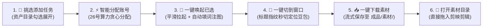

# Web 工作台：第一性原理极简重构与全链路闭环修改方案 (Master Plan)

> **文档版本**：v2.0 (全量终版 - 2026-10-13)  
> **设计哲学**：基于第一性原理，剔除所有冗余功能，重构为极致流畅的 **「选词排产 $\to$ 智能分配 $\to$ 一键唤起/秒切窗口 $\to$ 豆包自动填词 $\to$ 一键下载素材入库」** 纯净生产闭环。  
> **适用工程**：`C:\Users\admin\DeskBox\其他\Web工作台\`  

---

## 1. 业务逻辑第一性原理重构 (Before vs After)

### 1.1 现状操作逻辑痛点诊断
目前操作界面存在大量**重复按钮、虚假步骤与割裂状态**：
- ❌ **虚假状态**：界面中维护了「待剪辑」、「已出成片」复选框与筛选 Tab。但实际上，工作台的核心定位是**生成视频素材**，成片是最终在剪映等剪辑软件中完成的，在工作台维护这些手动状态徒增操作员心智负担；
- ❌ **手动打勾繁琐**：卡片右侧原本需要人工反复勾选「已发豆包」、「素材就绪」，但这些状态系统底层完全可以自动感知；
- ❌ **按钮冗余堆叠**：「➕ 新增任务」与「📁 从资产目录勾选添加任务」重复；「⚡ 启动待发前5条」、「按账号打开任务」与「🚀 一键唤起已选」功能冲突；
- ❌ **滚动找按钮痛苦**：任务多时，页面向下滚动，顶部的操作按钮全部被滚出视野，需要反复上下翻页；
- ❌ **窗口与任务失联**：唤起 20~26 个 Chrome 窗口后，操作员在桌面茫茫窗口中找不到某条任务具体在哪个窗口。

### 1.2 重构后的极简生产闭环

---

## 2. 核心改进清单与技术落地方案

### 改进一：任务与窗口深度强绑定，支持一键精准秒切窗口
- **原理与实现**：
  1. **动态标题指纹**：`vg_extension/content.js` 在加载任务后，自动将豆包标签页标题修改为：`[V01] 豆包 - <场景标题>`；
  2. **会话地址持久化**：进入具体会话后，`content.js` 向服务端回传该任务的会话 URL，保存在任务数据中；
  3. **任务卡片一键切窗**：在工作台卡片上增加 **`🎯 切到窗口`** 按钮；
  4. **系统级瞬间置顶**：点击时，服务端通过 `(New-Object -ComObject WScript.Shell).AppActivate('[V01]')` 直接在 Windows 桌面把该任务所在的具体 Chrome 窗口瞬间拉到最前台激活；若尚未拉起，则自动调起该 Profile 窗口。

---

### 改进二：固定顶部操作栏 + 列表滑轮独立滚动布局
- **UI 布局重构**：
  1. 页面布局改为 Viewport 视口自适应结构：
     - **顶部固定操作区**（Sticky Header）：高度固定，无论有多少条任务，操作栏永远固定在页面上方；
     - **下方列表滚动区**（Scrollable Kanban）：`overflow-y: auto; height: calc(100vh - 顶部高度)`，支持鼠标滚轮流畅滚动；
  2. 彻底告别上下翻找按钮的痛苦体验。

---

### 改进三：操作栏与任务卡片极致精简（断舍离）
- **顶部操作栏清理**：
  - **保留核心动作**：
    - `📁 挑选添加任务`（保留资产抽屉模式）
    - `⚡ 智能分配账号`
    - `🚀 一键唤起已选 (N)`
    - `📥 一键下载已选 (N)`
    - `📁 打开素材目录`
    - 辅助管理：`🖼️ 打开产品参考图`、`📅 历史快照`、`🗑️ 清空流水线`
  - **彻底删除的冗余按钮**：
    - ❌ 删除「➕ 新增任务」（与资产抽屉重复）
    - ❌ 删除「⚡ 启动待发前5条」（用户直接勾选后点“一键唤起已选”）
    - ❌ 删除「按账号打开任务」下拉与按钮
    - ❌ 删除「待剪辑」筛选 Tab
- **任务状态流转全自动化（卡片精简）**：
  - 彻底删除卡片右侧的手动复选框（已发豆包、素材就绪、已出成片）；
  - 任务生命周期改为系统全自动徽标流转：
    - ⚪ `待发送`（未唤起）
    - 🔵 `已发豆包`（扩展已成功注词注图）
    - 🟣 `🎬 视频就绪`（扩展已解密捕获无水印直链）
    - 🟢 `💾 素材已入库`（视频已下载到本地 `成品/素材/` 目录）
  - 顶部筛选 Tab 精简为 4 态：
    - `全部` / `待发送` / `视频就绪 (可下载)` / `素材已入库`
  - 卡片操作按钮精简为高频动作：
    - `🎯 切到窗口`（秒切回对应豆包标签页）
    - `🚀 唤起`（单个唤起）
    - `📥 下载`（单条视频就绪时出现）
    - `▶️ 预览`（成片在线播放）
    - `📄 查词` / `🗑️ 移除`

---

### 改进四：彻底弃用油猴脚本，全量收敛至原生插件
- **精简维护成本**：
  1. 彻底删除工程中两份无用的油猴脚本：
     - 删除 `C:\Users\admin\DeskBox\其他\Web工作台\doubao_auto_paste.user.js`
     - 删除 `C:\Users\admin\DeskBox\其他\Web工作台\public\doubao_auto_paste.user.js`
  2. 删除前端页面及文档中所有关于油猴脚本的按钮、超链接与安装提示；
  3. 解除 `RULE[AGENTS.md]` 中关于油猴同步的规则负担，全链路唯一以 `vg_extension` 为准。

---

### 改进五：插件 HUD 悬浮面板增加手动下载按钮
- **豆包端原生下载体验**：
  1. 在豆包网页右下角的 `vg_extension` HUD 面板中，当后台解密拦截到无水印成片后，高亮显示 **`📥 下载视频`** 按钮；
  2. 点击直接调用 Chrome 原生下载 API（`chrome.downloads.download`），自动命名为 `[V01]_场景标题.mp4` 保存至浏览器默认下载文件夹。

---

### 改进六：并发唤起防漏词漏图 + 视频全局防重与多版本保存
- **前台激活注入与 DOM 状态校验**：
  - 标签页激活可见（`visibilitychange`/`focus`）时秒级注入，后台静默打开时不盲目抢焦点；
  - 校验富文本输入框与图片附件 DOM（上限 10 张不截断），缺失自动补齐。
- **成片排他性防重与多版本支持**：
  - 会话穿透与 Tab 注册表，成片直链绝不上报空 `task_id`；
  - 服务端全局 URL 排他去重，杜绝同一个视频被连续赋给多个不同任务；
  - 单视频任务下载为 `V01_场景.mp4`，同一会话多次出片按多版本 `V01_场景_v1.mp4`、`V01_场景_v2.mp4` 分别入库；已存在文件跳过重复下载。

---

## 3. 修改文件与代码职责划分

| 文件路径 | 修改核心职责 |
| :--- | :--- |
| `public/index.html` | 1. 布局重构为顶部固定操作栏 + 列表滚轮滚动区； 2. 彻底清理冗余按钮、油猴文案与手动打勾步骤复选框； 3. 卡片增加「🎯 切到窗口」按钮与自动流转徽标； 4. 筛选 Tab 精简为 4 态。 |
| `vg_extension/content.js` | 1. 动态注入网页标题指纹 `[V01] 豆包`； 2. 任务持久化与向 Background 注册 Tab 映射； 3. 智能激活注入与 DOM 双重校验； 4. HUD 面板增加「📥 下载视频」原生下载按钮。 |
| `vg_extension/service-worker.js` | 1. 维护 `tabTaskMap`，解密出成片直链时携带准确 `task_id`； 2. 支持原生 `DOWNLOAD_MEDIA` 规范命名保存。 |
| `server.py` | 1. 新增 `/api/tasks/switch_window` 接口，基于指纹瞬间激活 Windows 对应窗口； 2. 重构 `/api/task/report_video`（排他去重与多版本追加）； 3. 重构 `/api/tasks/download_videos`（多版本命名与断点跳过）。 |
| 文件删除 | 彻底删除根目录与 `public/` 下的 `doubao_auto_paste.user.js`。 |

---

## 4. 实施顺序与验收 Checklist

- [ ] **步骤 1**：删除两份油猴文件，清理 `server.py` 与 `public/index.html` 中的油猴逻辑与相关提示。
- [ ] **步骤 2**：重构 `server.py`：新增切窗接口 `/api/tasks/switch_window`，重构成片防重与下载。
- [ ] **步骤 3**：重构 `vg_extension`：`content.js`（标题指纹、激活注入、HUD 下载按钮）与 `service-worker.js`（Tab 注册与精确上报）。
- [ ] **步骤 4**：重构 `public/index.html`：顶部固定栏 + 独立滚动区，清理所有冗余按钮与手动复选框，增加「切到窗口」。
- [ ] **步骤 5**：端到端生产流水线验证测试。
