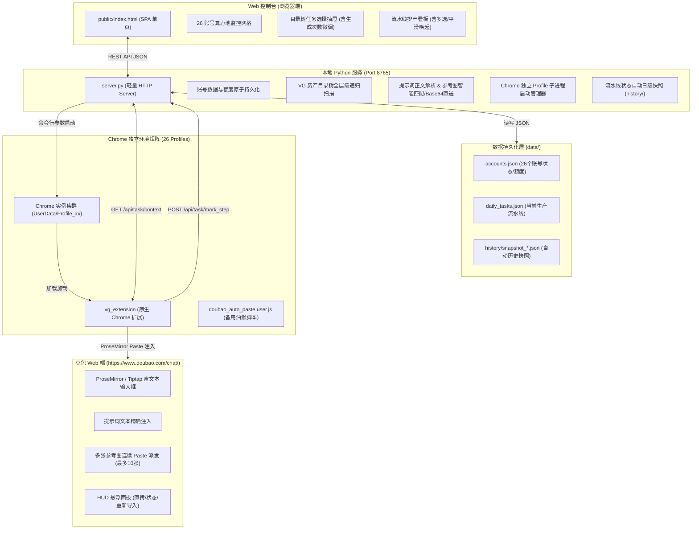

# VG 视频生产与 26 账号矩阵工作台 (Web工作台)
> **AI Agent 上下文导读与开发者架构手册 (AI Coding Guide & Developer Manual)**  
> 任何后续新对话或 AI 助手修改本项目前，**必须先完整阅读本文档**，可在 1 分钟内建立全景认知，避免破坏核心机制。

---

## 1. 项目定位与系统架构全景

### 1.1 项目定位
本项目是专为 **VG (Video Generation) 视频自动化批量生产流水线** 打造的全栈式排产与调度中枢。它解决了**多账号算力纳管、提示词文件树状检索、多任务拆解排产、Chrome 实例集群唤起、以及豆包 (Doubao) 聊天框零接触全自动注词注图**的全链路闭环。

### 1.2 系统架构拓扑


---

## 2. 核心目录与文件职责清单

```
C:\Users\admin\DeskBox\其他\Web工作台\
├── server.py                   # 后端核心：HTTP 服务、API路由、Chrome启动、参考图Base64直送、快照维护
├── start.bat                   # 快速启动批处理脚本（双击一键运行 server.py）
├── README.md                   # 本文档（系统架构与 Agent 开发指南）
├── doubao_auto_paste.user.js   # 备用油猴用户脚本（豆包自动填词注图）
├── public/                     # 前端静态资源目录
│   ├── index.html              # 前端全功能单页（SPA，26账号监控、流水线排产、任务抽屉、调度中心）
│   └── doubao_auto_paste.user.js # 供网页端“一键复制/安装油猴脚本”下载的同步镜像
├── vg_extension/               # 原生 Chrome 扩展插件（推荐方式，免油猴权限烦恼）
│   ├── manifest.json           # MV3 扩展配置，声明 doubao.com 匹配规则与 127.0.0.1 权限
│   └── content.js              # 内容脚本：HUD 悬浮挂件、ProseMirror富文本靶向注入、多图Paste上传
└── data/                       # 本地数据持久化
    ├── accounts.json           # 26 个 Chrome 资料账号信息（名称、10s/5s剩余额度、状态等）
    ├── daily_tasks.json        # 当前流水线正在执行的任务工单（任务ID、路径、绑定账号、各步骤状态）
    └── history/                # 流水线自动快照目录（每次保存或排产自动生成 snapshot_YYYYMMDD_HHMMSS.json）
```

---

## 3. 四大核心数据流与业务实现机制

### 3.1 任务选择与生成次数展开机制 (`repeatCount`)
- **交互入口**：前端「📁 从资产目录勾选添加任务」抽屉（`task-picker-drawer`）。
- **底层递归扫描**：`server.py` 的 `/api/vg/tree` 通过 `rglob` 扫描全层级目录，不论是一级产品直出脚本还是三级变体迁移目录，均能 100% 完整扫描并生成树状结构。
- **生成次数调整**：
  - 卡片自带步进器 `[-] [ 1 ] [+]`（支持 1~20 次，修改自动勾选卡片）；
  - 顶部工具栏提供「所选各生成 [ N ] 次」批量快捷应用；
  - 底部提交栏实时计算任务总数：`已勾选 M 个提示词，共计 N 条流水线任务`。
- **展开命名规范**：
  - 若提示词生成次数 $= 1$：保持原始场景名（例如 `高效接单`）；
  - 若提示词生成次数 $> 1$：以连续排列展开为多条独立任务，附带自增编号后缀（例如 `高效接单 #1`, `高效接单 #2`, `高效接单 #3`）；
  - 每条展开后的任务分配唯一的全局自增工单号（`V01`, `V02`, `V03`...），独立占有各自的账号分配和生命周期状态。

### 3.2 任务勾选与一键平滑唤起机制 (`launchSelectedTasks`)
- **自由多选**：看板卡片最左侧具备独立选择复选框（`task-select-cb`），支持表头「全选当前视图」、「勾选全部【待发送】」、「取消勾选」。
- **自动智能账号补齐**：勾选任务若存在未分配账号的条目，唤起前自动静默调用**智能贪心算法**（`autoAssignAccountsSmart(true)`），按 26 账号今日剩余额度自动均衡分配账号。
- **按账号智能聚合启动（防丢任务与 Profile 冲突）**：
  - 前端将勾选的所有任务自动按 `assignedAccount` 分组；
  - 同一个账号名下的多条任务，通过 `task_ids: [...]` **单次启动以多标签页形式整齐打开**，彻底避免短时间内针对同一 Profile 进程发起重复锁冲突；
  - 不同账号窗口之间按 **1.5 秒**平滑流式唤起，若总任务数超过 5 条弹窗确认；
  - Windows 调度任务 `VG_Launch_Profile` 设置为 `MultipleInstancesPolicy = Parallel`，批处理移除阻塞死等，确保高频触发零丢单；
  - 唤起完成后，系统**自动清空勾选状态**，便于无缝勾选下一批。

### 3.3 参考图智能识别、去重、顺序对齐与 Base64 直送机制
> ⚠️ **这是整个系统最精细的核心环节，后续开发切勿随意修改截断规则！**
- **正文提及捕获**：
  - 正则表达式 `re.findall(r"(\w+\.(?:png|jpg|jpeg|webp|PNG|JPG))", prompt_text)` 提取正文提到的所有图片；
  - 严格记录正文中**首次提及的自然顺序**（例如 `6.PNG` $\to$ `5.png` $\to$ `1.png` $\to$ `2.png`）。
- **同名去重与目录优先级**：
  - 扫描产品根目录下的 `产品参考图/`；
  - 若子目录（如 `旧/`）中存在同名文件，**严格以一级根目录文件为准去重**，过滤掉废弃老图。
- **全量 Base64 直送**：
  - **切勿截断为 2 张或 4 张**！凡是正文明确命中的参考图（上限放开至 **10 张**），`server.py` **100% 全量生成完整 Base64 直送数据**；
  - 未命中的主要参考图前 10 张也全量生成 Base64 作为保底；
  - Base64 直送彻底规避了浏览器内容脚本发起跨域网络请求、Mixed Content 拦截或路径包含中文等潜在失败风险。

### 3.4 豆包聊天框无感注词、注图与自动状态回传
- **目标页面与富文本适配**：
  - 豆包网页采用 ProseMirror / Tiptap 富文本框架，普通 `textarea.value = ...` 无法被框架内核感知；
  - 扩展脚本通过派发标准的合成 `ClipboardEvent('paste')`（将正文写入 `DataTransfer` 的 `text/plain`），完美触发 ProseMirror 内部原生处理管道。
- **多张参考图连续 Paste**：
  - 依次将图片的 Base64 转成 `File` 对象，置入 `DataTransfer.items.add(file)` 并派发 `paste` 事件；
  - **每张图片粘贴间隔 450ms**，保证豆包编辑器完成图片上传并生成缩略图，避免并发上传丢图。
- **自动扣减流水线与额度**：
  - 图片与文字全部成功填入后，扩展向本地服务端发起 `POST /api/task/mark_step`；
  - 本地服务自动将流水线该任务的 `sent` 置为 `true`，并将该账号的 `remaining_10s` 自动扣减 1 条，保存日级历史快照。

---

### 3.5 豆包成片无水印解密拦截与一键素材入库机制 (`download_videos`)
- **后台 DevTools 拦截与无水印解密**：
  - `vg_extension` 依托 Manifest V3 后台服务（`service-worker.js`），通过 Chrome Debugger API 监听豆包接口 `doubao.com/im/chain/single` 的响应数据；
  - 针对豆包返回的密文视频包（`fallback_api`），采用 `QAAB_SALT_HEX` 与 `key_seed` 进行 SHA-512 派生密钥与 AES-CBC 自动解密，无感析出 1080P 纯净无水印视频直链；
  - 扩展捕获视频后，自动向工作台汇报 `POST /api/task/report_video`，看板对应卡片点亮【🎬 视频就绪】紫色徽标。
- **一键下载到产品【成品/素材/】目录**：
  - 用户在工作台勾选任务后，点击「📥 一键下载已选视频」；
  - 后端 `server.py` 定位任务对应产品目录，自动确保创建 `VG/<产品名>/成品/素材/` 目录；
  - 按规范格式 **`【任务ID_场景标题.mp4】`**（例如 `V01_高效接单.mp4`）流式分块写入硬盘；
  - 下载完成后自动将工单标记为【💾 素材就绪 (`downloaded: true`)】，并记录 `local_video_path` 路径。
- **在线预览与一键打开素材目录**：
  - 点击卡片「▶️ 预览」，工作台弹出内嵌无水印播放器（优先加载本地文件，次选直链）；
  - 点击「📁 打开素材目录」，直接唤起 Windows 资源管理器定位到当前产品的 `成品/素材/` 目录。

---

## 4. 关键接口契约速查 (API Cheatsheet)

| 方法 | 路径 | 参数 / Body | 说明 |
| :--- | :--- | :--- | :--- |
| `GET` | `/api/accounts` | 无 | 获取所有 26 个账号的配置与今日剩余额度 |
| `POST`| `/api/accounts/update` | `{"id": "01_...", "delta_10s": -1, ...}` | 更新账号额度或状态 |
| `GET` | `/api/tasks` | 无 | 获取当前流水线工单列表 |
| `POST`| `/api/tasks/save` | `{"tasks": [...]}` | 保存当前流水线工单并生成历史快照 |
| `GET` | `/api/vg/tree` | 无 | 全层级深度扫描 VG 目录结构与提示词树 |
| `GET` | `/api/task/context` | `?task_id=V01` 或 `?account=01_...` | 获取指定任务全文、正文顺序参考图（含Base64） |
| `POST`| `/api/accounts/launch_task` | `{"account_id": "01_...", "task_id": "V01"}` | 启动指定 Chrome Profile 并打开带任务参数的豆包 |
| `POST`| `/api/task/mark_step` | `{"task_id": "V01", "step": "sent", "value": true}` | 标记任务流转步骤并联动扣减账号额度 |
| `POST`| `/api/task/report_video`| `{"task_id": "V01", "video_url": "..."}` | 扩展上报捕获到的无水印视频直链 |
| `POST`| `/api/tasks/download_videos` | `{"task_ids": ["V01", ...]}` | 服务端流式下载视频到对应产品的【成品/素材/】目录 |
| `GET` | `/api/video` | `?path=...` | 本地成片流式预览接口 |
| `POST`| `/api/vg/open_material_folder` | `{"product": "014_Lyft指示灯"}` | 唤起资源管理器打开产品素材目录 |
| `GET` | `/api/tasks/snapshots` | 无 | 获取历史自动保存的时间戳快照列表 |
| `POST`| `/api/tasks/restore_snapshot` | `{"filename": "snapshot_..."}` | 一键回滚恢复历史快照数据 |

---

## 5. 本地开发、调试与运维常用命令

### 5.1 启动 / 重启后台服务
```powershell
# 1. 直接双击运行 start.bat，或在命令行中运行：
python "C:\Users\admin\DeskBox\其他\Web工作台\server.py"

# 2. 服务运行端口：http://127.0.0.1:8765/
```

### 5.2 检验接口与参考图 Base64 状态
当怀疑参考图丢图或接口未返回 Base64 时，可使用一行 Python 快速自测：
```powershell
python -c "import urllib.request, json; res = json.loads(urllib.request.urlopen('http://127.0.0.1:8765/api/task/context?task_id=V01').read().decode()); [print(f'{img[\"name\"]} | matched: {img[\"matched\"]} | b64: {len(img.get(\"base64\", \"\")) > 100}') for img in res.get('data', {}).get('ref_images', [])]"
```

### 5.3 Chrome 原生插件更新与调试
- 原生插件源码目录：`C:\Users\admin\DeskBox\其他\Web工作台\vg_extension\`；
- 安装/调试入口：在 Chrome 中打开 `chrome://extensions`，开启「开发者模式」，点击「加载已解压的扩展程序」，选择上述目录；
- 若修改了 `content.js`，只需在扩展管理页面点击该扩展卡片上的 **刷新 🔄 图标**，并在已打开的豆包网页中按 F5 即可立即生效。

---

## 6. 后续修改高危避坑准则 (Agent Critical Rules)

> ⚠️ **AI 助手在后续对话中改动本工程代码时，必须严格遵守以下红线：**

1. **严禁硬编码图片截断限制**：
   - 历史教训：代码中曾因出现 `matchedImgs.slice(0, 2)` 和 `if len(ref_images) < 4`，导致 4 张参考图被强行截断丢失后两张；
   - 现行标准：正文命中的参考图及 Base64 直送上限已放宽至 **10 张**，绝不可在 `server.py`、`content.js` 或 `doubao_auto_paste.user.js` 中重新引入写死的小阈值截断！
2. **保持「原生扩展」与「油猴脚本」双向同步**：
   - 当改动 `vg_extension/content.js` 中的核心注词、注图、粘贴时序逻辑时，必须同步更新：
     - `doubao_auto_paste.user.js`
     - `public/doubao_auto_paste.user.js`
   - 确保双端用户体验与注入逻辑完全一致。
3. **保持服务与数据端口一致 (8765)**：
   - 扩展及油猴脚本所有 API 请求硬编码指向 `http://127.0.0.1:8765`，切勿随意更改端口号。
4. **保存数据必须保留日级快照**：
   - 所有变更 `daily_tasks.json` 的保存接口必须保留并调用 `save_daily_tasks(..., make_snapshot=True)`，这是用户回滚防误操作的生命线。
5. **遵循 VG 资产目录规范**：
   - 凡涉及在 `C:\Users\admin\DeskBox\其他\VG` 下新建或检索资产，严格遵循 `0XX_产品名/` $\to$ `脚本名/` $\to$ `迁移_xxx/` 三级树结构。
6. **时长规格动态算力换算（5s/10s/15s）**：
   - 系统根据提示词正文提取的时长规格（5s: 10条, 10s: 5条, 15s: 4条）按基准分值进行动态均衡调度与扣减，严禁硬编码写死固定 4 条或 5 条。
7. **账号禁用联动规范**：
   - 处于禁用状态（`status: 'disabled'`）的账号，必须在智能调度候选池和手动分配下拉菜单中 100% 过滤排除；在禁用时必须联动自动解绑当前流水线中分配给该账号且未发送的任务。

