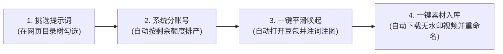

# VG 视频工作台极速上手指南 (小白/业务操作手册)

> 💡 **给新同学的一句话介绍**：  
> 这是一个**全自动做视频的流水线调度后台**。你只需要在网页上挑好想做的视频任务，点击“一键唤起”，它就会自动在各个浏览器账号里打开豆包，并把写好的**提示词**和**产品参考图**自动粘贴进对话框。视频生成完毕后，还能一键把**无水印成片**批量下载并整齐整理到电脑文件夹里！

---

## 目录
1. [零基础架构理解：这套系统是怎么帮你干活的？](#1-零基础架构理解这套系统是怎么帮你干活的)
2. [环境准备：第一次使用前只需做三件事](#2-环境准备第一次使用前只需做三件事)
3. [日常做视频：最核心的 4 步生产流](#3-日常做视频最核心的-4-步生产流)
4. [常用进阶功能速查](#4-常用进阶功能速查)
5. [常见问题与故障自查 (FAQ)](#5-常见问题与故障自查-faq)

---

## 1. 零基础架构理解：这套系统是怎么帮你干活的？

你平时人工做视频需要：
1. 找到写好的提示词文档，复制文字；
2. 找到产品参考图，一张张拖进浏览器；
3. 多个账号来回切换登录；
4. 视频生成后一个个手动保存、重命名、归档到指定文件夹。

**现在，工作台把上面这些杂活全部自动化了：**



---

## 2. 环境准备：第一次使用前只需做三件事

只要你的电脑准备好了，以后每天只需要双击启动即可！

### 第一件事：启动后台服务

根据你的电脑系统选择对应的启动方式：

- **Windows 电脑**：
  - 进入工作台文件夹，直接**双击运行 `start.bat`**。
  - 会弹出一个黑底窗口（服务运行窗口），看到显示 `服务已启动: http://127.0.0.1:8765/` 即表示成功。
  - ⚠️ **注意**：使用期间**不要关闭**这个黑色窗口，最小化即可。

- **Mac 苹果电脑**：
  - **方式一（双击启动）**：直接**双击运行 `start.command`** 即可自动唤起终端与网页（首次如果提示未授权权限，只需在终端运行一次 `chmod +x start.command`）；
  - **方式二（终端命令）**：打开终端，进入工作台目录，运行：
    ```bash
    ./start.sh
    ```
  - 系统会自动检测 Python 环境并在浏览器中自动打开工作台页面。

---

### 第二件事：打开网页控制台

打开 Chrome 浏览器（谷歌浏览器），访问地址：
👉 **`http://127.0.0.1:8765`**

你会看到工作台主界面：
- **上方**：账号矩阵监控（展示所有 Chrome 账号、剩余生成次数与额度）；
- **中间**：流水线排产看板（已选任务、待发送、已发送、视频生成状态）；
- **操作栏**：包含添加任务、自动分配、批量唤起、一键下载等按钮。

---

### 第三件事：安装浏览器插件 (仅首次需配置)

为了让工作台能把提示词和图片自动贴进豆包并抓取无水印成片，需要在 Chrome 浏览器中加载一次官方插件：

1. 在 Chrome 浏览器地址栏输入并回车：`chrome://extensions`
2. 打开右上角的 **「开发者模式」** 开关；
3. 点击左上角的 **「加载已解压的扩展程序」**；
4. 在弹出的文件选择窗口中，选择本项目的 **`vg_extension`** 文件夹；
5. 安装成功后，你的 Chrome 扩展栏就会出现 `豆包/Dola 无水印助手` 图标。

> 💡 **小贴士**：系统已全面收敛采用原生扩展方案 `vg_extension`（MV3 架构），提供最强大的富文本注词、多图上传、会话绑定、切窗置顶与无水印成片秒级解密能力！

---

## 3. 日常做视频：最核心的 4 步生产流

这是你每天最常使用的流水线生产流程：

```
挑选任务 ➔ 分配账号 ➔ 批量唤起自动注词 ➔ 一键流式下载入库
```

### 步骤 1：挑选提示词任务
1. 在工作台页面顶部点击 **「📁 挑选添加任务」**；
2. 页面弹出的目录树抽屉中，整齐列出了所有的产品（如 `014_Lyft指示灯`）和提示词；
3. 勾选你今天想要生成的场景或变体；
4. **调整生成次数**：
   - 每张任务卡片右侧有 `[-] [ 1 ] [+]` 按钮；
   - 如果你想让某个场景同时做 3 条，直接点成 3 次；
   - 顶部也可以使用「所选各生成 [ 2 ] 次」批量设置；
5. 点击底部的 **「🚀 批量加入流水线」**，任务就会自动进入流水线看板中（如果生成 3 次，会自动顺延展开为 `#1`、`#2`、`#3` 三条独立工单）。

---

### 步骤 2：分配账号
- 点击看板上方的 **「⚡ 智能分配账号」**，系统会根据你 26 个账号今日的剩余可用额度（5秒/10秒/15秒时长规格）进行贪心均衡分配，避免某个账号被透支。
- 也可以在卡片的下拉框中手动指定某个任务给特定账号做。

---

### 步骤 3：一键平滑唤起（自动填词与注图）
1. 切换到 **【待发送】** 分类标签，勾选想要立刻生成的任务（可点击「全选当前视图」或「勾选全部【待发送】」）；
2. 点击吸顶操作栏的 **「🚀 一键唤起已选」**；
3. **自动化全流程执行**：
   - 浏览器会自动打开对应账号的独立 Chrome 窗口并跳转到豆包；
   - 插件会在 1~2 秒内，自动把你的**提示词正文完整粘贴到输入框**；
   - 同时按顺序**将最多 10 张产品参考图逐张自动粘贴上传**；
   - 插件智能监听发送动作，你或系统点击发送后，HUD 自动转为 `🔵 豆包生成中`，工作台状态实时同步！
4. **随时精准切窗**：如果想查看某个任务的生成进展，直接在卡片上点击 **「🎯 切到窗口」**，系统瞬间将该任务所在的 Chrome 窗口置顶到最前台！

---

### 步骤 4：一键流式下载与进度可视化
1. 豆包生成视频后，插件在后台会自动截获 1080P 纯净无水印直链；
   - *（系统内置 15 秒生成防护，彻底规避误读历史旧消息错报）*
2. 工作台任务卡片亮起绿紫色的 **【🎬 视频就绪】** 徽标；
3. 点击卡片上的 **「▶️ 预览」** 可在线无缝播放成片；
4. 勾选就绪任务，点击看板顶部的 **「📥 一键下载已选」**：
   - 系统采用**逐条流式串行推进模式**，每张卡片内部直接显示**独立的动态百分比进度条**（`⏳ 正在请求素材...` $\to$ `⏳ 正在拉取视频流...` $\to$ `📥 正在写入磁盘...` $\to$ `✅ 下载完成并入库！`）；
   - 下载完成瞬间自动打勾转为 **【💾 素材已入库】**，并自动顺畅流转推进到下一条任务；
   - 成片整齐保存在：`VG/0XX_产品名/成品/素材/【任务ID_场景标题.mp4】`；
5. 点击顶部的 **「📁 打开素材目录」**，电脑直接弹出该文件夹，剪辑师直接取用！

---

## 4. 常用进阶功能速查

| 功能 | 在哪里操作 | 怎么用 / 解决什么问题 |
| :--- | :--- | :--- |
| **🎯 一键切到窗口** | 每张任务卡片操作区 | 点击瞬间穿透置顶该任务所在的 Chrome 独立窗口，快速人工干预或查看对话 |
| **📊 卡片独立下载进度条** | 任务卡片内部 | 逐条串行平滑流式推进，直观呈现 0%~100% 下载进度与入库状态秒级流转 |
| **🛡️ 分类切换净化勾选** | 顶部状态筛选栏 | 从【全部】切换到【待发送】等分类时，自动清理不在当前视图的隐形勾选，杜绝误操作 |
| **账号禁用 / 启用** | 顶部账号网格右上角开关 | 某个账号被风控或需要休息时，关闭开关，系统排产时会自动跳过它，并自动解绑未发送的任务 |
| **额度手动校准** | 顶部账号卡片点击数字 | 如果人工在别处消耗了次数，直接点击数字输入真实剩余次数即可校准 |
| **历史快照回滚** | 操作栏「📅 历史快照」 | 不小心手滑删除了任务？点击历史快照，随时一键恢复到几分钟前的任何历史状态 |
| **查看产品参考图** | 顶部操作栏「🖼️ 打开参考图」 | 直接唤起系统文件夹，查看对应产品存放的原始参考图片 |

---

## 5. 常见问题与故障自查 (FAQ)

### Q1: 双击 `start.bat` 窗口一闪而过关闭了，或者打不开 `127.0.0.1:8765`？
- **原因 1**：电脑上可能没有安装 Python，或者环境变量没配。
  - **解决**：打开命令行输入 `python --version` 确认是否有 Python（建议 3.9+）。
- **原因 2**：8765 端口被其他软件占用了。
  - **解决**：检查是否之前已经打开过一个黑框窗口，如果有，直接使用旧窗口即可，不要重复双击。

### Q2: 豆包网页打开了，但是输入框是空的，没有自动粘贴文字和图片？
- **原因 1**：Chrome 插件没有启用。
  - **解决**：打开 `chrome://extensions`，确认 `豆包/Dola 无水印助手` 开关是否处于开启状态。
- **原因 2**：页面右下角没有悬浮球。
  - **解决**：刷新一下豆包网页（按键盘 F5 或 Ctrl+R / Command+R）。刷新后如果看到右侧出现工作台的小悬浮面板，说明连接正常。
- **原因 3**：任务参数丢失。
  - **解决**：回到工作台，重新勾选该任务点击唤起，确保网址后面带有 `?vg_task=Vxx` 的参数。

### Q3: 为什么刚打开网页，有的任务就显示就绪？
- **已彻底解决**：最新版本引入了 15 秒生成生命周期校验与严格 1 对 1 任务 ID 绑定，页面初次打开加载历史消息遗留的旧视频会被 100% 自动拦截，绝不会再发生刚发送就显示就绪的误判。

### Q4: 换了 Mac 电脑，怎么操作？
- 工作台已经全面自适应 macOS！
- 终端运行 `./start.sh` 或双击 `start.command`，在浏览器打开工作台，操作完全一致。唤起账号时会自动调用 Mac 原生 Chrome 多 Profile 窗口并弹出 Finder 文件夹。

---

🎉 **祝你生产愉快，视频条条爆单！如有系统改动需求，请参考《AGENT_MODIFY_GUIDE.md》。**


